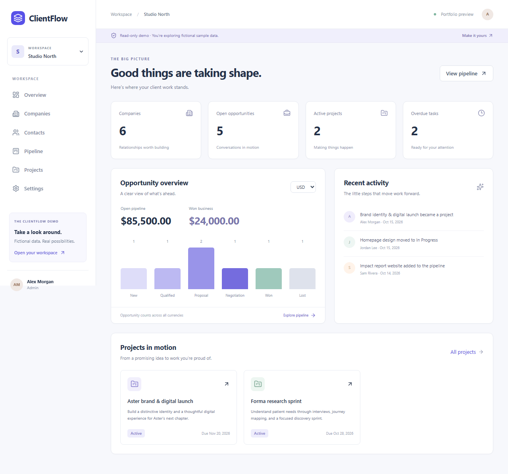

# ClientFlow

ClientFlow is a multi-tenant CRM and project management application for small teams. It connects client relationships, sales opportunities, and project delivery in one workspace.



## Features

- Company and contact management with search, pagination, and archive/restore.
- Sales pipeline with table and Kanban views, accessible stage selection, and won-deal conversion.
- Projects and tasks with assignments, priorities, due dates, and progress tracking.
- Reporting with currency-specific totals and a transactional activity feed.
- Organization roles, single-use invitations, and protection against removing the last administrator.
- An isolated read-only demo with sample data, available without external services.

## Technology

| Area | Stack |
| --- | --- |
| Backend | .NET 10, ASP.NET Core controllers, EF Core, PostgreSQL |
| Frontend | React, TypeScript, Vite, React Router, Tailwind CSS, Radix/shadcn-style components |
| Authentication | Auth0 Universal Login and JWT bearer validation |
| Data fetching | TanStack Query with tenant-scoped caching and optimistic updates |
| Testing | xUnit, HTTP integration tests, Vitest, Playwright |
| Operations | Docker Compose, GitHub Actions, optional OpenTelemetry |

## Run with Docker Compose

Docker Desktop (Linux containers) and Docker Compose are sufficient; host installations of Node.js and .NET are not required.

1. Copy `.env.example` to `.env` if it does not already exist.
2. Set `POSTGRES_PASSWORD`, `AUTH0_DOMAIN`, `AUTH0_CLIENT_ID`, and `AUTH0_AUDIENCE`. See [Auth0 setup](docs/auth0-setup.md) for the API and SPA registration.
3. Start the stack:

```powershell
docker compose up --build -d --wait
```

Open **http://localhost:5173/app**, or **http://localhost:5173/demo** for sample data. The API is also available at `http://localhost:5080`. Compose starts PostgreSQL, applies EF migrations through a one-shot service, waits for API readiness, and serves the React production build through Nginx. Frontend `/api` requests are proxied to the API on the internal Docker network. All published ports bind to localhost.

The stack is configured for local HTTP development. Auth0 remains an external service; blank or invalid settings do not enable an authentication bypass. Configure the SPA callback as `http://localhost:5173/app`, and logout/web origins as `http://localhost:5173`. If `FRONTEND_PORT` changes, update these URLs in Auth0 as well. The production frontend embeds its public Auth0 settings at build time: rerun `docker compose up --build -d --wait` after changing them. Docker does not load `frontend/.env.local` into images; Compose reads the root `.env`.

### Optional database browser

```powershell
docker compose --profile tools up --build -d --wait
```

Open **http://localhost:8081** for Adminer. Choose **PostgreSQL**, use server **postgres**, and enter `POSTGRES_USER`, `POSTGRES_PASSWORD`, and `POSTGRES_DB` from `.env`. The default user/database are `clientflow`. No separate Adminer account is required. A prefilled link for those defaults is `http://localhost:8081/?pgsql=postgres&username=clientflow&db=clientflow`.

To add only the browser to a running stack: `docker compose up -d adminer`. To stop it: `docker compose stop adminer`. The optional service is excluded from normal startup.

### Optional hot reload

```powershell
docker compose -f docker-compose.yml -f docker-compose.dev.yml --profile tools up --build -d --wait
```

This runs `dotnet watch` and Vite against mounted source files at the same ports. Linux backend build outputs are isolated from host build outputs. Rebuild after dependency changes. New EF migrations require rebuilding/restarting the migration service; the watch process does not apply schema changes itself.

### Logs and shutdown

```powershell
docker compose logs -f api frontend migrate
docker compose --profile tools down
```

Normal shutdown preserves the `postgres-data` volume. Removing that volume deletes the local database. Changing `POSTGRES_PASSWORD` in `.env` does not change the password of an already initialized PostgreSQL volume; use its existing credentials or deliberately update the database role.

For database-only support while running the API/frontend on the host, use `docker compose up -d --wait postgres`.

## Explore without configuration

Requires Node.js 24 LTS (or a compatible version >=22.12).

```powershell
cd frontend
npm ci
npm run dev
```

Open `http://localhost:5173/demo`. This is a read-only workspace with deterministic fictional data and the same presentation components as the authenticated product. It never calls the backend. `/app` displays a sign-in availability message when authentication is not configured. Normal screens never fall back to sample data.

## Run the API and frontend on the host

From the repository root, with .NET SDK 10 installed:

```powershell
dotnet restore ClientFlow.slnx --locked-mode
dotnet tool restore
Copy-Item .env.example .env
# Edit .env with a local PostgreSQL password.
docker compose up -d --wait postgres
$env:ConnectionStrings__ClientFlow = 'Host=localhost;Port=5432;Database=clientflow;Username=clientflow;Password=YOUR_LOCAL_PASSWORD'
dotnet ef database update --project backend/ClientFlow.Infrastructure
```

Use your existing PostgreSQL server instead if preferred. Migrations are explicit; startup does not apply them. Back up existing data before applying migrations. `CompleteWorkspace` adds the new tables and concurrency/profile fields without deleting existing organizations, memberships, or users. Existing display names initialize to `Team member`.

Follow [Auth0 setup](docs/auth0-setup.md), then configure the API:

```powershell
dotnet user-secrets set 'Auth0:Domain' 'YOUR_TENANT_REGION.auth0.com' --project backend/ClientFlow.Api
dotnet user-secrets set 'Auth0:Audience' 'YOUR_API_IDENTIFIER' --project backend/ClientFlow.Api
dotnet run --project backend/ClientFlow.Api --launch-profile http
```

The connection environment variable must still be set in the API terminal. Alternatively use `Auth0__Domain`, `Auth0__Audience`, and `ConnectionStrings__ClientFlow`. Checked-in Auth0 settings stay empty. The API validates required settings and has no authentication bypass.

In another terminal:

```powershell
cd frontend
Copy-Item .env.example .env.local
# Fill the Auth0 domain, SPA client ID, and the same API audience.
npm ci
npm run dev
```

API: `http://localhost:5080`. Frontend: `http://localhost:5173`. Development CORS permits this frontend origin. For a different origin, configure `Cors__AllowedOrigins__0` and Auth0 together. Frontend `VITE_API_URL` is the API origin without `/api`.

Sign in, choose/create an organization, and update your display name in Settings. Admins can create invitation links in Settings. Share the link manually; it grants Member access to the authenticated person holding it. There is no email delivery or email restriction. The token is shown only on creation, expires after seven days, and cannot be reused. It is carried in a URL fragment and only its hash is stored in PostgreSQL.

## Product behavior

- Both roles manage business records. Only Admins rename organizations, invite people, change roles, or remove members. The last Admin is protected with aggregate rules and optimistic concurrency.
- Companies, contacts, opportunities, projects, and tasks use archive/restore. Historical relationships remain visible. Archived parents cannot be selected for new relationships. A contact's company is fixed to preserve deal history; archive it and create a contact at another company when necessary.
- Opportunities can move between all six stages, including reopening Won/Lost. A contact must belong to the selected company. Convert a won deal through its detail page; repeating conversion opens the same project. The project keeps its original name/source and is independent of later deal edits.
- Tasks belong to projects, can be assigned to organization members, and have date-only due dates, descriptions, statuses, and priorities. Removing a member clears assignments while retaining historical activity.
- Progress is the rounded percentage of non-archived tasks marked Done; an empty project is 0%. Reports exclude archived business records. Monetary totals are separated by currency and never converted. Overdue tasks exclude completed/cancelled or archived projects.
- Every update carries a version. Stale updates return 409 and the UI offers reload. Pipeline moves roll back on failure. Data caches are scoped by identity and organization and cleared on switching/logout.
- Lists support bounded search, paging, archival filters, relevant relationship/status filters, and allowlisted sorting. The board shows the current page, identified in its footer. Member lists show the organization roster; invitation history shows the latest 100.

## Verification

```powershell
dotnet build ClientFlow.slnx -c Release --no-restore
dotnet test ClientFlow.slnx -c Release --no-build
dotnet publish backend/ClientFlow.Api -c Release -o artifacts/api
cd frontend
npm run build
npm test
npx playwright install chromium
npm run test:e2e
```

`frontend/dist` is the static production build; `artifacts/api` is the API publish output. Serve the frontend with SPA fallback to `index.html` for `/app`, `/invite`, and `/demo` routes. Only `dist` should be hosted, never the frontend source directory. Vite embeds public environment values at build time; rebuild when changing them. No client secret belongs in frontend configuration.

The default HTTP suite uses SQLite and the real JWT middleware with locally signed test tokens. Its issuer/signing-key fixture lives only in the test project. For PostgreSQL verification:

```powershell
$env:CLIENTFLOW_TEST_POSTGRES = $env:ConnectionStrings__ClientFlow
dotnet test ClientFlow.slnx -c Release
Remove-Item Env:CLIENTFLOW_TEST_POSTGRES
```

Use a test account permitted to create databases. Tests create/migrate a random `clientflow_tests_*` database and remove that database afterward; they do not clear your configured application database. PostgreSQL-only tests verify migrations, conversion uniqueness, stale administrator changes, and competing invitation consumption. These are explicitly skipped without this variable. SQLite results do not establish PostgreSQL compatibility.

Browser tests include real demo navigation and a separate **simulated API** test entry under `frontend/tests/`; they are not live Auth0/full-stack verification. This entry is excluded from production output. CI runs backend builds, SQLite tests, PostgreSQL tests, frontend builds/component tests, and Chromium browser tests. See the workflow runs in GitHub Actions for CI results.

See the [testing guide](docs/verification.md) and [manual acceptance checklist](docs/review-checklist.md) for test coverage and environment requirements.

## Architecture and API

The backend is organized into API, Common, Application, Infrastructure, and Domain projects, controller endpoints, typed configuration, shared index constants, and registration extensions. Application coordinates use cases through interfaces; Domain owns invariants; Infrastructure owns EF mappings and transactions. See [MVP architecture](docs/mvp-architecture.md) and [API contract](docs/api.md). Development OpenAPI is available at `/openapi/v1.json`.

Important changes and their activity records commit together. `X-Correlation-ID` and Problem Details trace IDs support troubleshooting. Structured request logs exclude tokens, request bodies, and query strings. Optional OpenTelemetry uses `Telemetry:Enabled`, `ServiceName`, and `OtlpEndpoint`; it is disabled by default. Keep EF sensitive-data logging disabled.

## Scope

The application focuses on CRM, sales, and project delivery. Payments, email automation, uploads, chat, AI features, exchange-rate conversion, and native mobile applications are outside its current scope. Hosting and external service provisioning are environment-specific.
